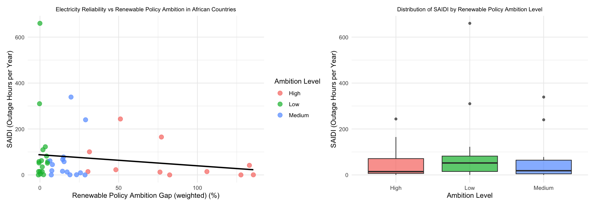
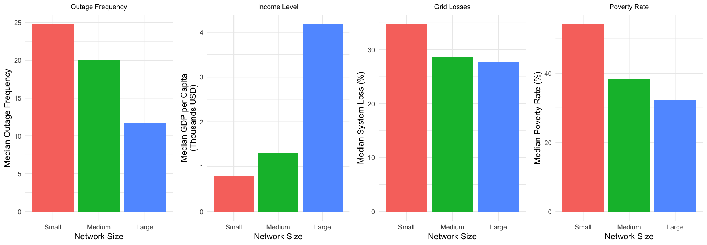
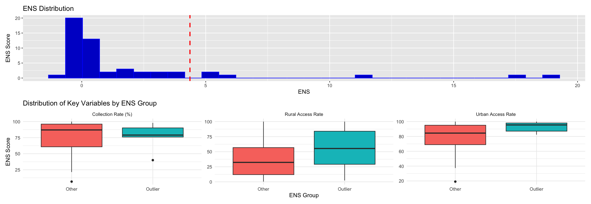
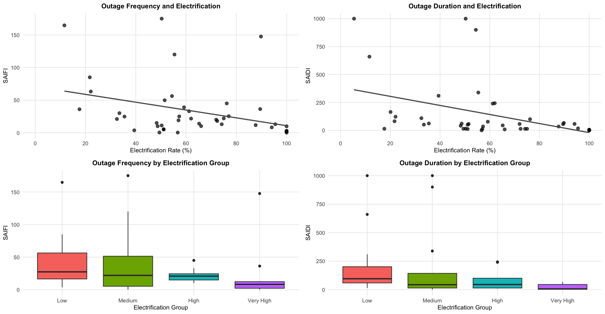

# Why Do African Power Grids Fail?

**An exploratory data analysis in R of what drives electricity reliability across 54 African countries: policy ambition, wealth, infrastructure quality, or access?**

We analyse data from the Clean Air Task Force (CATF) to help inform its *Electricity Sector Performance Scorecard* (CATF-ESPS). We look at how often the power goes out (**SAIFI**), how long outages last (**SAIDI**), and how much demand goes unmet (**ENS**), and how these relate to renewable-energy targets, GDP, grid losses, poverty and electrification.

> **About this repository:** this was a team project for a statistics course at the University of Toronto. It was built in **March 2026** on the university's JupyterHub (RStudio) server and presented as a slide deck. The JupyterHub environment had no version control, so the project was **uploaded to GitHub in November 2026**. The first commit is the final presentation exactly as submitted. Later commits reorganize the code, fix errors found on review, and add tests and documentation.

---

## Key findings

| | Finding |
|---|---|
| **Policy ambition** | Countries with more ambitious renewable targets tend to have *shorter* outages. Their current renewable share is low, though, so this probably reflects stronger planning capacity rather than renewables themselves. |
| **Wealth and infrastructure** | From small to large networks, median outage frequency halves (24.8 → 11.7 per year), GDP per capita rises five-fold ($0.8k → $4.2k), and grid losses fall (34.8% → 27.7%). |
| **Extreme shortfalls** | The six countries with extreme Energy Not Supplied actually have *higher* rural and urban access rates, so access alone doesn't explain the worst shortages. |
| **Access vs reliability** | Higher electrification goes with fewer and shorter outages on average, but some well-electrified countries still have severe outages. |

## Research questions

Each team member led one question:

| # | Question | Led by |
|---|---|---|
| Q1 | How does the gap between renewable targets and current renewable generation relate to reliability? | Capucine Crouzet |
| Q2 | How do grid losses, income and outage frequency differ across countries grouped by network size? | Maria Ramos |
| Q3 | How do countries with extreme Energy Not Supplied differ in electrification and utility finances? | Aminaa Enkhbat |
| Q4 | How is reliability (outage duration and frequency) related to electrification rate? | Vineet Koushal |

## Figures

**Q1: Reliability vs renewable policy ambition**


**Q2: Outages, income, grid losses and poverty by network size**


**Q3: Countries with extreme Energy Not Supplied**


**Q4: Electrification and reliability**


## Methods

- **Cleaning.** The raw data has about 11 rows per country, one per data source. We collapse it to one row per country, using the **median** for numeric variables and the **mode** for text variables ([`R/clean_data.R`](R/clean_data.R)).
- **Derived variables.** These include total system loss (distribution + transmission), a weighted renewable *ambition gap*, a renewable diversity index (1 − Σ shares²), network-size terciles, electrification quartiles, and ENS outliers using the 1.5 × IQR rule.
- **Analysis.** We compared groups with box plots, bar charts of group medians, and scatter plots with linear trend lines. All results are descriptive associations, not causal estimates.

## Known data limitations

- **Mixed units across sources.** Some sources report rates as fractions (0.99) and others as percentages (99), and population sometimes appears in millions. Using medians limits the effect, but it doesn't remove it entirely.
- **Different years.** Variables aren't guaranteed to come from the same year for every country.
- **Small groups and missing values.** For example, there are only 6 ENS outliers, and many countries are missing renewable-target data.

## Project structure

```
├── analysis/
│   └── african_grid_reliability.qmd   # The full analysis as Quarto Beamer slides
├── R/
│   └── clean_data.R                   # Data cleaning functions
├── tests/testthat/                    # Unit tests for the cleaning functions
├── figures/                           # Figures generated by the analysis
├── data/CATF_data.csv                 # CATF dataset (see "Data" below)
├── DEPENDENCIES.R                     # Installs the R packages used
└── .lintr                             # Code-style settings
```

## Reproducing the analysis

Requires **R 4.1+**. Rendering the slides also needs [Quarto](https://quarto.org) and a LaTeX installation (for example `quarto install tinytex`).

```bash
Rscript DEPENDENCIES.R                       # install packages
Rscript -e 'testthat::test_dir("tests/testthat")'   # run the tests
Rscript -e 'lintr::lint_dir("R")'                   # check code style
cd analysis && quarto render african_grid_reliability.qmd   # build the slides (PDF)
```

## Data

Electricity-sector indicators for African countries were compiled by the [Clean Air Task Force](https://www.catf.us/) and provided to the course for this project.

The dataset is in [`data/CATF_data.csv`](data/CATF_data.csv). It has 585 rows (several sources per country) and 42 variables covering demographics, access, reliability (SAIDI, SAIFI, ENS), utility finances, grid losses and renewable targets.

## Team

**Aminaa Enkhbat · Capucine Crouzet · Maria Ramos · Vineet Koushal**

**My contributions (Maria Ramos):** <!-- TODO: describe your part, e.g. "Led Q2: built the network-size grouping and total system loss variable, and produced the comparison charts and summary table" -->
